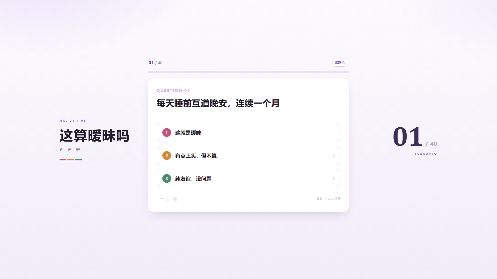
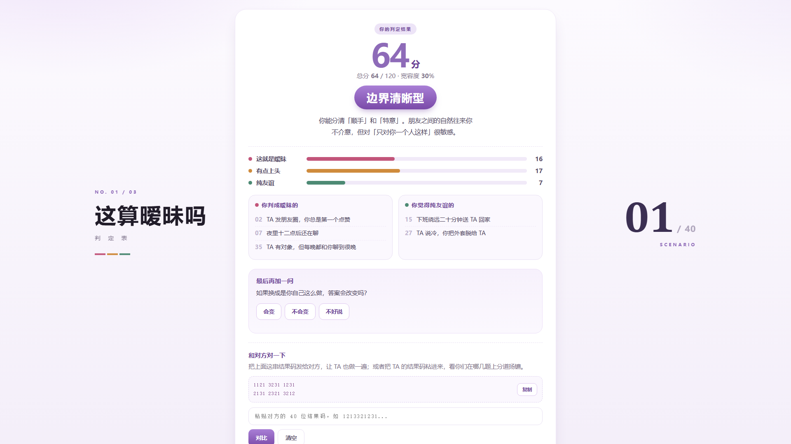

# 这算暧昧吗？判定表

> 40 个场景，测你和 TA 之间那段还没名字的关系。


一个**单文件、零依赖、可离线**的互动测试页面。双击 `index.html` 就能玩，不需要构建、不需要联网、不需要后端。



---

## 这是什么

这是一张用来「对答案」的表，不是心理量表。

它只测一种关系：**还没在一起，但已经不像朋友**的那段模糊期。没有第三者、没有前任、没有"要不要抢"——所有题目都发生在你们两个人之间。每一题问的其实是同一句话：

> 名不正言不顺的亲密，算不算数。

40 道题分三段递进：

| 段落 | 题目 | 关注什么 |
|---|---|---|
| 一 | 01–13 | 手机里的信号：晚安、秒赞、听两遍的语音 |
| 二 | 14–27 | 身体先知道：送回家、一把伞、多抱的半秒 |
| 三 | 28–40 | 我们算什么：称呼、对外表述、不敢问的那句 |

---

## 判定规则

每题三档，核心不是行为本身有多亲密，而是**区别对待**和**隐瞒**：

| 档位 | 标准 | 一句话 |
|---|---|---|
| **1** 这就是暧昧 | 这个行为只对 TA 做，或者刻意瞒着别人 | 不是动作有问题，是"只对你"有问题 |
| **2** 有点上头，但不算 | 行为本身常见，但你心里清楚自己在意 | 事不大，心不干净 |
| **3** 纯友谊，没问题 | 换任何人来做你都觉得正常 | 你甚至不会多想一秒 |

## 结果分型

总分 120（1/2/3 加权），按平均分六档：

| 平均分 | 类型 |
|---|---|
| < 1.35 | 雷达全开型 |
| < 1.70 | 一眼看穿型 |
| < 2.05 | 边界清晰型 |
| < 2.40 | 看场合型 |
| < 2.75 | 钝感型 |
| ≥ 2.75 | 纯友谊信徒型 |



除了分数，结果页还会列出你判成暧昧的题、你觉得纯友谊的题，并生成一串 40 位结果码——发给对方，两个人可以逐题对比，看边界差在哪几题。

---

## 快速开始

**方式一（最简单）**：双击 `index.html`。

**方式二（本地起个服务，行为和线上一致）**：

```bash
python -m http.server 8000
# 打开 http://localhost:8000
```

如果需要录屏：浏览器宽度 **≥ 1400px** 时，两侧会出现装饰栏（左边栏目名、右边大字题号），低于这个宽度会自动收起成手机版。

---

## 部署到 GitHub Pages

1. 把这个仓库 push 到 GitHub。
2. Settings → Pages → Source 选 `Deploy from a branch`，Branch 选 `main` / `root`，保存。
3. 等半分钟，访问 `https://<你的用户名>.github.io/<仓库名>/`。

> 本仓库已部署，在线地址：**https://xiaobaigyt.github.io/aimei-checklist/**

单文件应用不需要任何构建步骤，改完 `index.html` 直接提交就生效。

---

## 改成你自己的版本

整个项目就一个 `index.html`，改四件事就能变成你的：

| 想改什么 | 搜什么 | 说明 |
|---|---|---|
| 40 道题 | `var QUESTIONS = [` | 数组长度不用动，改成你自己的题就行（注意 `N` 会自动取长度） |
| 三档文案 | `这就是暧昧` / `有点上头` / `纯友谊` | 换名字时记得同时改「图例」「按钮」「结果页三条分布」三处 |
| 配色 | `:root{` | 六个颜色变量控制全站，改 `--pink` 系列即可整体换色 |
| 人设分型 | `function typeOf(avg)` | 六档阈值和描述都在这，删到三档也能跑 |

如果你想做「职场版」「室友版」「家人版」，改题 + 改档位文案就够了，交互逻辑不用碰。

---

## 项目结构

```
.
├─ index.html            # 全部代码（HTML + CSS + JS），单文件
├─ questions.json        # 40 题的数据镜像，供程序化使用
├─ tools/
│  └─ extract_questions.py   # 从 index.html 重新导出 questions.json
├─ docs/                 # 截图（01-cover / 02-quiz / 03-result）
├─ LICENSE               # 代码：MIT
└─ LICENSE-CONTENT.md    # 内容：CC BY-NC-SA 4.0
```

> `questions.json` 是从 `index.html` 导出的镜像，**以 `index.html` 为准**。改了题目后跑一次 `python tools/extract_questions.py` 就能同步。

---

## 许可证

本项目采用**双许可**：

- **代码**（HTML / CSS / JavaScript）→ [MIT](LICENSE)。随便用，商用、闭源、二次开发都行，保留版权声明即可。
- **内容**（40 条题目、文案、分型描述）→ [CC BY-NC-SA 4.0](LICENSE-CONTENT.md)。可以转载、改编，但**必须署名、不得商用、改编后同样开放**。

简单说：**代码你尽管拿去改，题目别拿去卖。** 如果是付费课程、带广告的小程序这类商业用途，先开 issue 聊一下。

---

## 来源与致谢

- 40 条题目、三档判定、六型描述均为本项目原创。
- 交互结构（单题一屏 / 三档打分 / 结果分型 / 对比码）首发于同作者的上一期作品《这算出轨吗？判定表》，那一期的原始量表来自日本 VTuber 健屋花那（@sukosuko_sukoya，设计 @air_trpg）。**本仓库不包含该作品及其译文。**

## 免责声明

这是一个用来聊天、对答案的娱乐性测试，不是心理学量表，也没有任何诊断价值。分数和类型都是玩笑着加的，真正有用的部分是你和对方在哪几题上分道扬镳。